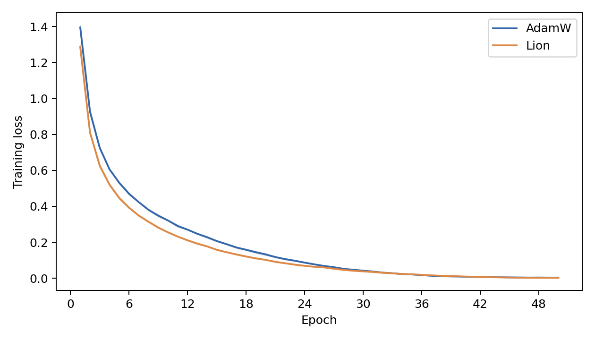
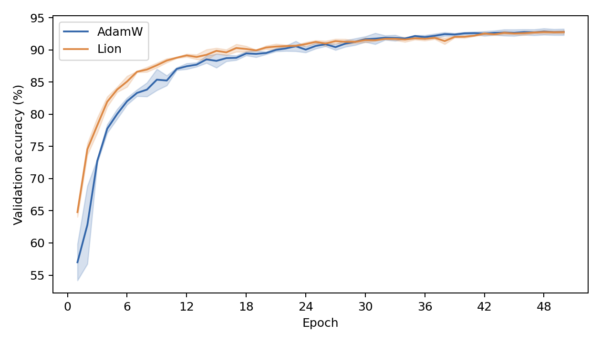
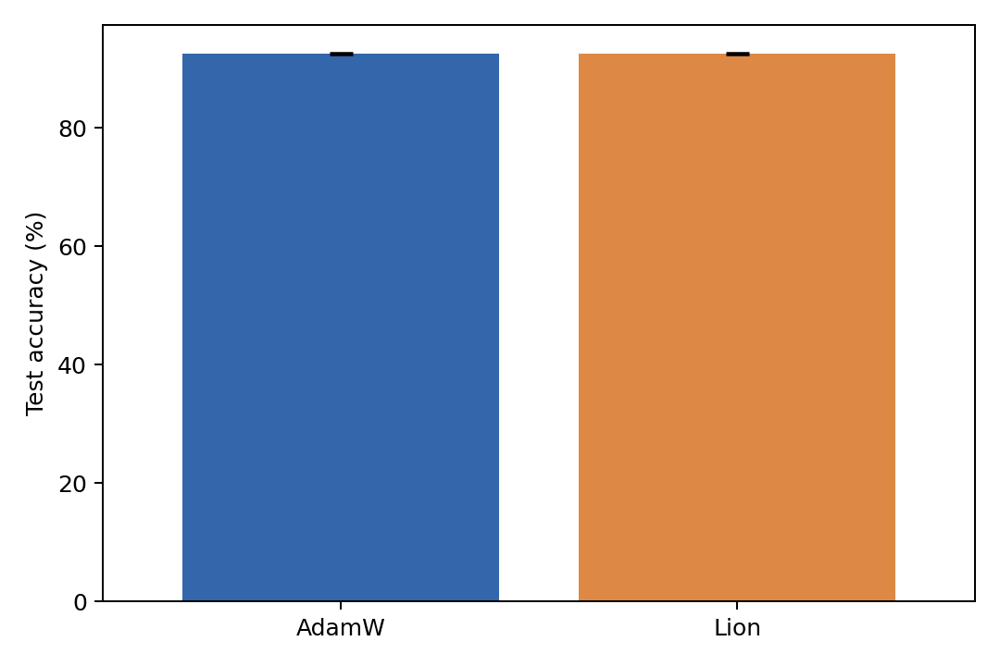
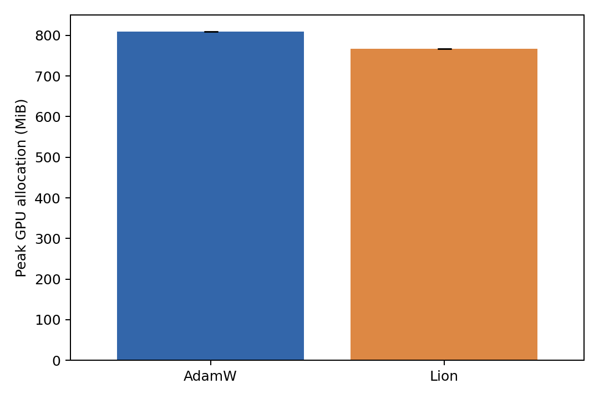
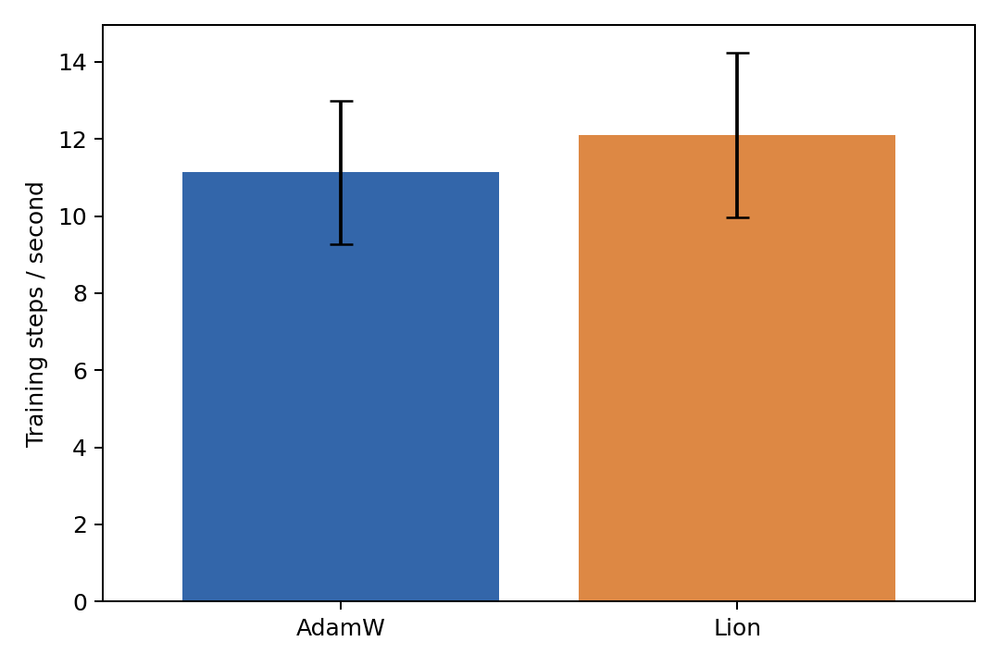
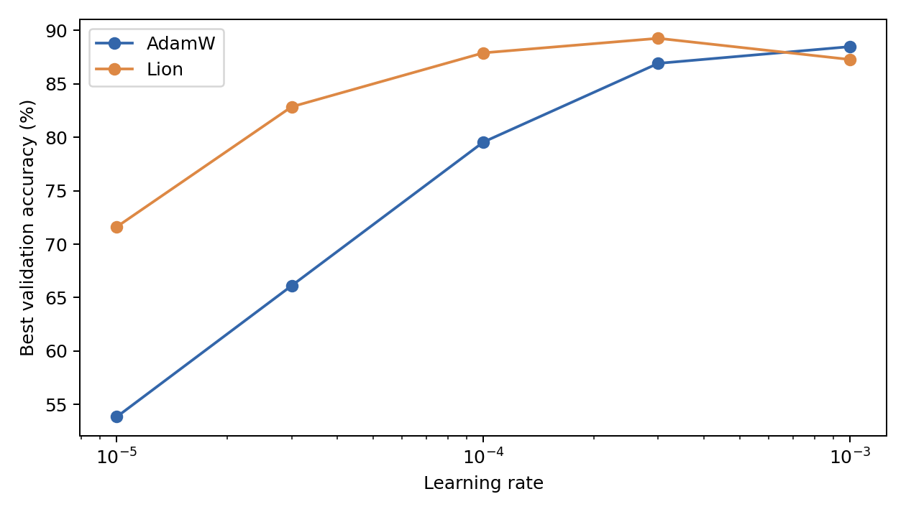
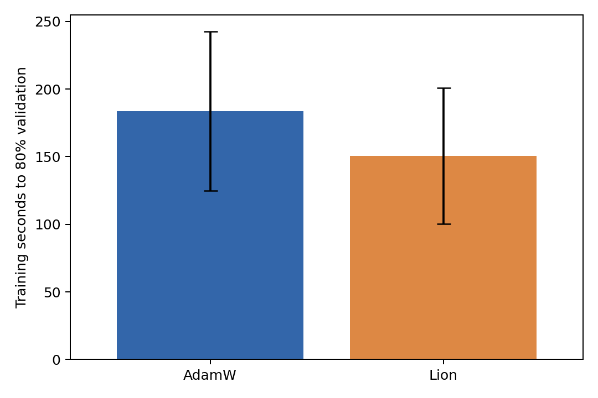

# A comparative trial of AdamW and Lion

**Author: Sky Lu**

> Beyond Adam: can Lion discard the second-moment state while preserving optimization quality and improving efficiency?

A reproducible PyTorch experiment comparing **AdamW** and **Lion** on **CIFAR-10 with ResNet-18**. The repository includes the complete experiment code, equal-budget tuning results, six final runs, per-epoch measurements, descriptive statistics, and seven figures. All reported measurements come from actual training. No result is generated from an assumed winner.

## Measured results

The table reports **mean ± sample standard deviation** over seeds **42, 123, and 2026**. Test evaluation uses the final, 50th-epoch model. Standard deviation is descriptive variation across runs, not a confidence interval.

| Metric | AdamW | Lion |
|---|---:|---:|
| Test accuracy (%) | 92.503 ± 0.200 | 92.510 ± 0.092 |
| Test cross-entropy loss | 0.4300 ± 0.0054 | 0.4887 ± 0.0050 |
| Optimizer-state memory (MiB) | 85.25 ± 0.00 | 42.63 ± 0.00 |
| Peak GPU allocated memory (MiB) | 809.63 ± 0.00 | 767.37 ± 0.00 |
| Training throughput (steps/s) | 11.13 ± 1.85 | 12.11 ± 2.14 |
| Training time per run (s) | 1609.54 ± 255.51 | 1487.98 ± 292.13 |
| Training time to 80% validation accuracy (s) | 183.77 ± 58.95 | 150.60 ± 50.27 |

**Interpretation:** observed test accuracy is nearly identical. Lion uses about half the optimizer-state memory and 5.2% less peak GPU allocation, and reaches moderate validation accuracy in fewer epochs. Lion's test loss is higher in every seed. Average throughput is 8.8% higher, but the advantage varies substantially between runs. These observations support an efficiency tradeoff in this setting, not universal superiority or proven statistical equivalence.

Raw evidence: [final runs](results/gpu_full/final_results.csv), [summary statistics](results/gpu_full/summary_statistics.csv), [report](results/gpu_full/report.txt), and [tuning results](results/gpu_full/tuning_results.csv).

## Experiment design

| Setting | Value |
|---|---|
| Dataset | CIFAR-10 |
| Training / validation / test images | 45,000 / 5,000 / 10,000 |
| Split seed | 42, fixed across all runs |
| Model | ResNet-18 without pretrained weights |
| CIFAR stem | 3×3 convolution, stride 1, padding 1, no max pooling |
| Output classes | 10 |
| Training batch size | 128, last partial batch retained |
| Final training | 50 epochs per run, 352 steps per epoch |
| Final seeds | 42, 123, 2026 |
| Loss | Cross-entropy, no label smoothing |
| Scheduler | CosineAnnealingLR, one step per epoch, minimum LR 0 |
| Precision | FP32, no AMP |
| Additional training features | No warmup, gradient clipping, or gradient accumulation |
| Checkpoint for test | Final epoch, selected before test evaluation |

Training augmentation uses `RandomCrop(32, padding=4)` and `RandomHorizontalFlip(p=0.5)`. All splits use channel means `[0.4914, 0.4822, 0.4465]` and standard deviations `[0.2470, 0.2435, 0.2616]`. Validation and test use no random augmentation.

Both optimizers share the same split indices, architecture, initial weights for each seed, loader seeds, augmentation, scheduler policy, and evaluation procedure. Initial-weight SHA-256 values in the saved summaries verify the pairing. Python, NumPy, PyTorch, CUDA, and data-loader worker RNGs are seeded. Deterministic algorithms are enabled.

**Validation selects hyperparameters. Test evaluates final models only.**

### Optimizers and selected hyperparameters

| Optimizer | Initial LR | Weight decay | Betas | Other settings |
|---|---:|---:|---|---|
| Official `torch.optim.AdamW` | 0.001 | 0.00001 | (0.9, 0.999) | eps=1e-8, foreach=False, fused=False |
| Custom Lion | 0.0003 | 0.0001 | (0.9, 0.99) | One persistent momentum tensor per parameter |

Both apply decoupled weight decay to all model parameters, including bias and BatchNorm parameters. These efficiency results compare these specific implementations, not the fastest available kernels for every optimizer.

Lion's update is:

```text
c_t     = beta1 * m_(t-1) + (1 - beta1) * g_t
u_t     = sign(c_t)
theta_t = (1 - lr_t * weight_decay) * theta_(t-1) - lr_t * u_t
m_t     = beta2 * m_(t-1) + (1 - beta2) * g_t
```

Here `theta` is a model parameter, `g` is its gradient, `m` is momentum, `lr` controls step size, and `weight_decay` controls parameter shrinkage. Lion's `beta1` constructs the current update direction and `beta2` updates stored momentum. Lion retains momentum history while removing AdamW's squared-gradient second-moment state.

### Equal-budget tuning

Each optimizer receives the same candidates and ten epochs per candidate, with tuning seed 42:

1. **LR search:** `[1e-5, 3e-5, 1e-4, 3e-4, 1e-3]`, holding WD at `1e-4`.
2. **WD search:** `[1e-5, 1e-4, 1e-3, 1e-2]`, holding each optimizer's selected LR fixed.
3. Select by the highest validation accuracy observed during the candidate's ten epochs. Resolve ties by lower LR, then lower WD.

The budget is **18 tuning runs + 6 final runs**, or **480 epochs**, plus two separate 2-epoch sanity runs. Tuning and final training use cosine schedules with `T_max` equal to that stage's epoch budget.

## Installation

Use **Python 3.10 or later** with a compatible PyTorch/torchvision pair. Create a virtual environment first:

```bash
python -m venv .venv
```

Activate it:

```bash
# Linux / macOS
source .venv/bin/activate

# Windows PowerShell
.\.venv\Scripts\Activate.ps1
```

Install PyTorch and torchvision using the command appropriate for your hardware from the [official PyTorch installer](https://pytorch.org/get-started/locally/), then install the remaining requirements:

```bash
python -m pip install --upgrade pip
python -m pip install -r requirements.txt
python experiments/check_environment.py
```

The recorded experiment used Windows, Python 3.14.3, PyTorch 2.14.1+cu130, torchvision 0.29.1+cu130, CUDA runtime 13.0, and an NVIDIA GeForce RTX 4060 Laptop GPU. [environment-gpu.lock.txt](environment-gpu.lock.txt) records its exact package versions. It is an environment record, not a portable CUDA installer. Other hardware/software can produce different numerical and timing results.

## Run the experiment

Run commands from the repository root. **Published measurements stay in `results/gpu_full/` and `plots/gpu_full/`; new training writes to ignored `runs/` directories.**

### 1. Test the code and run a sanity check

```bash
python -m unittest discover -s tests -p "test_*.py" -v
python tools/audit_final.py
python experiments/sanity_check.py
```

Unit tests use small, explicitly synthetic fixtures without network access. They do not produce published experimental results. The separate sanity check uses real CIFAR-10: 2,048 training images, 512 validation images, two epochs, seed 42, LR 0.001, WD 0.0001. It checks both optimizers and saved artifacts without accessing the test set. Its outputs are isolated under `runs/default/`.

The default configuration downloads CIFAR-10 automatically and uses CUDA when available, otherwise CPU. Without CUDA, GPU memory is unavailable, stored as blank numeric CSV fields or JSON null. CPU execution of the full budget can take a long time.

### 2. Run tuning and final training

```bash
python experiments/tune_lr.py
python experiments/tune_weight_decay.py
python experiments/final_experiment.py
python -m src.evaluate
```

After the sanity check, LR search is the next stage. Final training automatically generates the report and figures; `src.evaluate` can regenerate them from saved measurements.

For the same loader and device settings as the recorded GPU study, use the fresh-output configuration:

```bash
python experiments/run_all.py --config configs/reproduce_gpu.yaml
```

This runs sanity, LR search, WD search, all final seeds, and reporting sequentially. It requires working CUDA and writes to `runs/gpu_reproduction/`. To execute individual GPU stages, pass the same `--config configs/reproduce_gpu.yaml` to each command above.

If the standard dataset download is interrupted, `python experiments/prepare_data.py --config configs/reproduce_gpu.yaml` provides an optional range downloader with official archive checksum verification.

### 3. Monitor or recover your own training

```bash
python tools/progress.py --results runs/gpu_reproduction/results
python experiments/resume_experiment.py --config configs/reproduce_gpu.yaml
```

Run the recovery command only after the original training process has stopped. It checks the configuration, reuses complete matching runs, archives incomplete runs, and restarts an interrupted candidate or seed from its initial weights. **It does not resume from an intermediate epoch.** Recovery requires the checkpoints produced by your local run. Checkpoints are intentionally absent from the published result snapshot.

For a separate experiment, copy a configuration and change both output paths. Existing nonempty runs are not silently overwritten.

### Inspect the included results without retraining

```bash
python tools/audit_final.py
python -m src.evaluate --config configs/experiment_gpu.yaml
```

The original `experiment_gpu.yaml` is preserved for provenance and report regeneration. Do not use it to start new training in the published result directory. Regenerating figures needs the saved CSV files, not CIFAR-10 or model checkpoints, and does not repeat test evaluation.

## Figures and interpretation

### 1. Training loss



Lion reduces training loss faster early and midway. Both fit the training set closely by epoch 50. Lower training loss does not guarantee lower test loss.

### 2. Validation accuracy



Lion first reaches 80% and 90% validation accuracy in fewer epochs. AdamW first reaches 92% earlier in all three seeds. Lines and shading show mean ± sample SD.

### 3. Final test accuracy



The mean difference is only 0.0067 percentage points. Paired Lion-minus-AdamW differences are +0.30, 0.00, and -0.28 percentage points. There is no consistent accuracy winner. Lion has higher test cross-entropy in every seed.

### 4. Peak GPU allocated memory



Lion saves about 42.25 MiB or 5.2% of peak allocation. Optimizer-state memory falls by about 50%, but parameters, gradients, and activations remain. The overall GPU footprint does not halve.

### 5. Training throughput



Lion averages 8.8% more steps/s, but is slower for seed 42, faster for seed 123, and only slightly faster for seed 2026. Descriptive means do not establish a stable optimizer-specific speed advantage.

### 6. Learning-rate sensitivity



Lion peaks at LR `3e-4` and falls 1.98 percentage points at `1e-3`. AdamW improves through the tested upper boundary. The curves show different preferred LRs, not proof that Lion is generally more sensitive.

### 7. Time to 80% validation accuracy



Lion's average training time to the 80% target is 18.1% shorter. All six runs reach the target and continue to epoch 50. This measure is separate from total training time and is sensitive to runtime variation.

## Metric definitions and limitations

- **Accuracy:** sample-weighted top-1 correct predictions, in percent. Test results evaluate six individual models, not an ensemble.
- **Cross-entropy:** sample-weighted negative log probability of the correct class. It is not an error percentage. Higher Lion loss does not, by itself, identify a calibration problem.
- **Training time:** sum of train-pass times, including loading, transfer, forward/backward, parameter updates, and metric accumulation. CUDA synchronizes at timing boundaries. Validation, testing, and saving are excluded.
- **Throughput:** total training steps / accumulated training time. This is an end-to-end training metric, not an optimizer-kernel benchmark.
- **Peak memory:** PyTorch `max_memory_allocated`, reset before training and sampled before final test evaluation. It covers training and validation. It is not reserved memory or total `nvidia-smi` usage. Columns ending in `_mb` use **MiB**.
- **Optimizer state:** persistent tensor bytes, including AdamW's scalar step tensors.
- **Time to target:** cumulative train-pass seconds through the first epoch meeting validation accuracy ≥80%. Accuracy is checked once per epoch. Unreached targets remain NaN rather than zero. The figures report available seed counts when observations are missing.
- **Statistics:** mean and sample SD (`ddof=1`) over three seeds. They do not establish significance, equivalence, or non-inferiority.
- **Scope:** one dataset, one architecture, three final seeds, one tuning seed, and a short tuning horizon. AdamW's best LR is at the search boundary. The study compares complete, separately tuned configurations, so changes cannot be attributed solely to removing a state tensor.
- **Timing conditions:** runs execute sequentially, AdamW then Lion within each seed, without a dedicated benchmark warmup. Laptop operating conditions varied, and some attempts were interrupted and restarted. Only completed runs enter the published summaries. Timing variation limits causal speed claims.
- **Reproducibility:** paired initialization and deterministic settings improve repeatability; bitwise equivalence across different PyTorch versions, CUDA runtimes, and devices is not guaranteed.

## Repository layout

```text
configs/
  experiment_config.yaml       Portable defaults; new outputs in runs/default/
  experiment_gpu.yaml          Original recorded GPU configuration
  reproduce_gpu.yaml           Same GPU settings with fresh output paths
src/                           Data, model, optimizers, training, metrics, reporting
experiments/                   Sanity, tuning, final training, recovery, diagnostics
tests/                         Offline mathematical and pipeline regression tests
tools/                         Published-result audit and progress reader
results/gpu_full/               Formal CSV, JSON, report, and per-run histories
plots/gpu_full/                 Seven measured comparison figures
docs/REPRODUCIBILITY.md         Environment, provenance, and artifact details
environment-gpu.lock.txt       Exact recorded environment
requirements.txt               Installation dependencies
CITATION.cff                   Repository citation metadata
.github/workflows/tests.yml    CPU tests and published-result checks
```

Datasets, virtual environments, package caches, model checkpoints, sanity outputs, interrupted attempts, and presentation build files are excluded. The included histories and summaries are sufficient to regenerate the seven figures, but not to restore trained model weights.

## References and authorship

Experiment and repository: **Sky Lu**. Experiment engineering and documentation used AI assistance. This is an independent comparison, not the original Lion implementation repository.

- Chen et al., [Symbolic Discovery of Optimization Algorithms](https://arxiv.org/abs/2302.06675), the Lion paper.
- [Official Lion reference implementation](https://github.com/google/automl/tree/master/lion).
- [PyTorch AdamW documentation](https://docs.pytorch.org/docs/stable/generated/torch.optim.AdamW.html).
- [CIFAR-10 dataset](https://www.cs.toronto.edu/~kriz/cifar.html).

No license is provided for the original code and documentation in this repository. Public availability does not itself grant an open-source license. Third-party software and datasets retain their respective terms.
